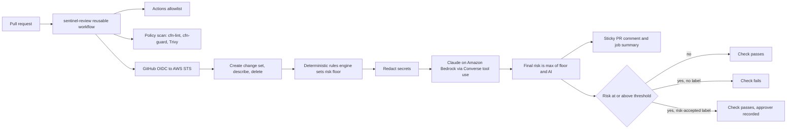

<div align="center">

# 🛡️ changeset-sentinel

**AI-assisted review for infrastructure changes.**
Every CloudFormation pull request gets a change set, policy checks, and a Claude-written risk report with a rollback plan before anyone clicks merge.

[](https://github.com/TyroneMadison/changeset-sentinel/actions/workflows/ci.yml)


</div>

> **Status:** unit tests (101), the offline demo against four recorded change sets, cfn-lint, cfn-guard and checkov all pass locally and in CI. Live use needs the OIDC role from [docs/DEPLOY.md](docs/DEPLOY.md); the screenshots folder fills in after that run.

---

## 🎯 Overview

**The problem.** A CloudFormation diff in a pull request hides the consequences that matter. Changing one property on a database can make CloudFormation *replace* it, which means a new empty instance and a deleted old one. Reviewers see a two line YAML diff and approve.

**What sentinel does.** On every PR it asks CloudFormation what would actually happen (a change set, created for review and deleted, never executed), scores that with deterministic rules, has Claude on Amazon Bedrock write the blast radius, data loss risks and an ordered rollback plan, and posts it as one sticky PR comment. HIGH and CRITICAL changes block the merge until a human applies the `risk-accepted` label, which is recorded as approval evidence.

**The outcome.** The person approving a change sees *replacement of AppDatabase, data does not carry over, snapshot first with this command* instead of `Engine: mysql` becoming `Engine: postgres`.

## ⚖️ Why it matters for regulated platforms

Platforms that serve legal research, financial services or healthcare live under SOC 2 and ISO 27001 style change management. Auditors ask three questions about every production change: what was the risk, who approved it, and how would you roll it back. Sentinel answers all three in the PR itself:

- **Risk:** a deterministic rule ID and level for every resource change, plus the AI narrative.
- **Approval:** the gate names the person who applied `risk-accepted`, pulled from the GitHub label event.
- **Rollback:** an ordered plan that is honest about data. CloudFormation rollback restores infrastructure, not rows.

The comment is the audit trail. No separate change ticket has to be kept in sync.

## 🏗️ Architecture



Sequence diagram, trust boundaries and failure modes: [docs/ARCHITECTURE.md](docs/ARCHITECTURE.md).

## ✨ Key features

- **Change sets, never executions.** The review role has an explicit Deny on ExecuteChangeSet and every stack mutation.
- **AI can raise risk, never lower it.** Rules set the floor; the model adds judgment on top. A model outage falls back to the rule-based report and the gate still runs.
- **Secrets never reach the model.** Key based and pattern based redaction, with the count printed in every report. Hardcoded secrets in a template are also a HIGH finding.
- **Structured output.** Bedrock Converse with forced tool use returns JSON that matches a schema, so every report has the same sections.
- **Human approval gate.** A label, not a bypass. The approver's GitHub login lands in the comment.
- **Supply chain guard.** Every `uses:` reference must be on the allowlist and pinned to a tag or SHA. The repo dogfoods it in CI.
- **Org policy as code.** cfn-guard rules for encryption, public access, snapshot policies, admin wildcards, required tags and open admin ports.
- **Golden path for new services.** One script gives a new service a starter stack and a reviewed pipeline.

## 🧰 Platform capabilities demonstrated

| Capability | Where in the repo |
|---|---|
| Reusable GitHub Actions workflow | [`.github/workflows/sentinel-review.yml`](.github/workflows/sentinel-review.yml) |
| Composite actions | [`actions/`](actions) (changeset, policy-scan, ai-review, allowlist) |
| OIDC authentication to AWS, no static keys | [`bootstrap/github-oidc.yaml`](bootstrap/github-oidc.yaml) |
| Least privilege IAM with explicit Deny | [`bootstrap/github-oidc.yaml`](bootstrap/github-oidc.yaml) |
| CloudFormation change set review and rollback planning | [`actions/changeset/changeset.sh`](actions/changeset/changeset.sh), [`sentinel/risk.py`](sentinel/risk.py) |
| Policy as code | [`policy/rules/`](policy/rules) (cfn-guard) |
| Scanner integration | cfn-lint, cfn-guard and Trivy in [`actions/policy-scan`](actions/policy-scan/action.yml); checkov in [CI](.github/workflows/ci.yml) |
| CI action allowlist enforcement | [`policy/actions-allowlist.yml`](policy/actions-allowlist.yml), [`sentinel/allowlist.py`](sentinel/allowlist.py) |
| Service templates and scaffolding | [`templates/new-service/`](templates/new-service), [`scripts/new-service.sh`](scripts/new-service.sh) |
| CodeBuild managed runners | `runs-on` input, [docs/CODEBUILD_RUNNERS.md](docs/CODEBUILD_RUNNERS.md) |
| LLM integration with guardrails | [`sentinel/llm.py`](sentinel/llm.py), [`sentinel/redact.py`](sentinel/redact.py), [`sentinel/review.py`](sentinel/review.py) |
| Audit evidence for change management | [`sentinel/gate.py`](sentinel/gate.py), [`sentinel/github.py`](sentinel/github.py) |

## 🚀 Quick start: local demo

No AWS account or API key needed. The demo replays four recorded change sets.

```bash
git clone https://github.com/TyroneMadison/changeset-sentinel.git
cd changeset-sentinel
python -m pip install -r requirements-dev.txt -e .
python -m sentinel demo
```

Real output:

```text
Scenario                       Floor     Final     Gate     Top finding
-----------------------------------------------------------------------
01-tag-change                  LOW       LOW       pass     SENT010 Tag-only change on AppBucket
02-rds-engine-change           CRITICAL  CRITICAL  blocked  SENT001 Stateful resource replacement on AppDatabase
03-open-ssh-security-group     HIGH      HIGH      blocked  SENT004 Network exposure change on AppSecurityGroup
04-iam-wildcard                HIGH      HIGH      blocked  SENT003 Access control change on AppPolicy
```

Excerpt from `out/02-rds-engine-change.md` (full report: [docs/SAMPLE_REPORT.md](docs/SAMPLE_REPORT.md)):

> ### Data loss risks
> - AppDatabase: data does not carry over to the new resource; a final snapshot is taken, but restore is manual and writes made after the snapshot are lost.
>
> ### Rollback plan
> 1. Revert the PR commit and let the pipeline build a fresh change set from the previous template. Do not hand edit resources in the console.
> 2. Before executing, back up AppDatabase: `aws rds create-db-snapshot --db-instance-identifier sentinel-demo-app-appdatabase-kq81nzt0w7xe --db-snapshot-identifier pre-change-appdatabase`
> 3. CloudFormation rollback restores infrastructure, not data. Recovery means restoring AppDatabase from that backup and pointing the stack at it.

Review a single change set yourself:

```bash
python -m sentinel review --changeset examples/scenarios/04-iam-wildcard/changeset.json --provider mock
```

## 🔌 Use it in your repo

```yaml
name: infra-review
on:
  pull_request:
    types: [opened, synchronize, reopened, labeled, unlabeled]
    paths: ["infra/**"]
jobs:
  sentinel:
    uses: TyroneMadison/changeset-sentinel/.github/workflows/sentinel-review.yml@v1
    permissions: { id-token: write, contents: read, pull-requests: write, issues: read }
    with:
      template-path: infra/template.yaml
      stack-name: sentinel-my-service
      role-to-assume: ${{ vars.SENTINEL_ROLE_ARN }}
```

Optional inputs: `parameters-file`, `risk-threshold` (default HIGH), `llm-provider` (bedrock, anthropic, none), `model-id`, `approval-label`, `allowlist-policy`, `runs-on`.

New service from scratch:

```bash
scripts/new-service.sh billing-api ../my-repo
```

## 🔐 Deploy the OIDC role

One CloudFormation stack creates the GitHub OIDC provider and a review-only role scoped to one repository, one stack name prefix and one Claude model:

```bash
aws cloudformation deploy --region us-east-2 --stack-name changeset-sentinel-oidc --template-file bootstrap/github-oidc.yaml --capabilities CAPABILITY_IAM --parameter-overrides GitHubOrg=TyroneMadison GitHubRepo=changeset-sentinel StackNamePrefix=sentinel-
```

Enable Claude Sonnet 4.5 under Bedrock **Model access** first and confirm the model IDs in the console. The full walkthrough, including a live PR that gets blocked and then approved, is in [docs/DEPLOY.md](docs/DEPLOY.md).

## 💰 Cost

| Item | Cost (at time of writing, verify current) |
|---|---|
| Claude Sonnet 4.5 on Bedrock (3 USD per M input tokens, 15 USD per M output) | about 2 cents per review for the demo scenarios; prompts are capped at 60k characters, which keeps a very large stack under 10 cents |
| OIDC provider, IAM role, change sets | free |
| GitHub hosted runners | free for public repos |
| Live demo stack (RDS db.t4g.micro) | about 0.02 USD per hour, torn down after the demo |

## 🧪 Testing

```bash
make lint       # ruff
make test       # 101 offline tests
make iac        # cfn-lint on every template
make guard      # cfn-guard rules against the demo stack and starter template
make allowlist  # this repo checked against its own allowlist
make demo       # recorded scenarios end to end
```

Tests cover the risk engine per scenario, the floor rule, redaction (including a check that the prompt never contains the planted secret), Converse and Anthropic response parsing, provider failure fallback, the label gate, sticky comment create versus update across paginated comments, label actor lookup, and the allowlist. The change set script was exercised against a fake AWS CLI for the update, create, review in progress, no changes and failure paths.

## 📁 Project structure

```text
changeset-sentinel/
├── .github/
│   ├── workflows/            ci, reusable sentinel-review, live demo-review
│   └── copilot-instructions.md
├── actions/                  composite actions: changeset, policy-scan, ai-review, allowlist
├── bootstrap/                github-oidc.yaml (OIDC provider + review-only role)
├── docs/                     architecture, deploy guide, risk rules, CodeBuild runners, sample report
├── examples/
│   ├── demo-stack/           small app stack used for the live demo
│   └── scenarios/            four PR scenarios with template.yaml and recorded changeset.json
├── policy/                   cfn-guard rules and the actions allowlist
├── scripts/                  new-service.sh scaffolder
├── sentinel/                 Python package (parser, rules, redaction, providers, report, gate)
├── templates/new-service/    starter stack and caller workflow
├── tests/                    pytest suite, offline
├── AGENTS.md  CLAUDE.md      instructions for Codex and Claude Code
└── Makefile
```

## 🧠 Design decisions and tradeoffs

- **Deterministic floor, AI ceiling.** Models are good at explaining consequences and spotting context (a security group still allowing 3306 after a move to Postgres) but they are not a control. The rules engine is the control; the model can only make the report more cautious. That keeps the gate predictable, testable and auditable.
- **Change sets over template diffs.** Only CloudFormation knows whether a property change means replacement. Asking it with `--include-property-values` beats re-implementing the resource specification.
- **Review role cannot deploy.** Separation of duties: the pipeline that judges a change must not be able to ship it. The explicit Deny survives future policy edits.
- **Fail safe on model errors.** A Bedrock outage must not block every infra PR, and must not silently pass risky ones. The rule-based report still posts and the gate still runs.
- **New roles are MEDIUM.** Every new stack adds roles and security groups. Blocking all of them trains people to click through. Changes to existing access and wildcard grants stay HIGH.
- **Policy failures are not overridable.** The `risk-accepted` label accepts judgment calls about risk. It does not waive org policy such as open SSH, which needs a template fix.
- **Trivy starts at CRITICAL.** cfn-guard holds the org rules. Trivy is the broad safety net and starts at CRITICAL so an existing estate is not blocked on day one; teams raise it once their baseline is clean.
- **Standard library HTTP.** The GitHub client uses urllib so the action installs fast and the dependency surface stays small.
- **Inputs through env.** Every workflow input reaches shell through `env:` to avoid script injection from PR controlled values.

## 🛡️ Security

Review only IAM, OIDC without static keys, fork PRs cannot assume the role, secrets redacted before any model call, pinned and allowlisted actions. Details and vulnerability reporting: [SECURITY.md](SECURITY.md).

## 🗺️ Roadmap

- Templates over 51,200 bytes through an S3 template URL
- Nested stack drill down with `--include-nested-stacks`
- Terraform plan support using the same rules engine and report
- Post the report as a GitHub check run annotation as well as a comment
- Cache the cfn-guard build between runs

## 🤖 Built with Claude

Designed and built by **Tyrone Madison** with **Claude** by Anthropic as an AI pair programmer. Every commit in this repository is co-authored by Claude.

The repo ships [`CLAUDE.md`](CLAUDE.md), [`AGENTS.md`](AGENTS.md) and [`.github/copilot-instructions.md`](.github/copilot-instructions.md), so Claude Code, OpenAI Codex and GitHub Copilot all understand the architecture, commands and guardrails (never execute a change set, never let the model lower the floor) out of the box.

## 👤 Author

**Tyrone Madison**, AWS Cloud and DevOps Engineer

[github.com/TyroneMadison](https://github.com/TyroneMadison) · [linkedin.com/in/tyrone-madison](https://linkedin.com/in/tyrone-madison)
