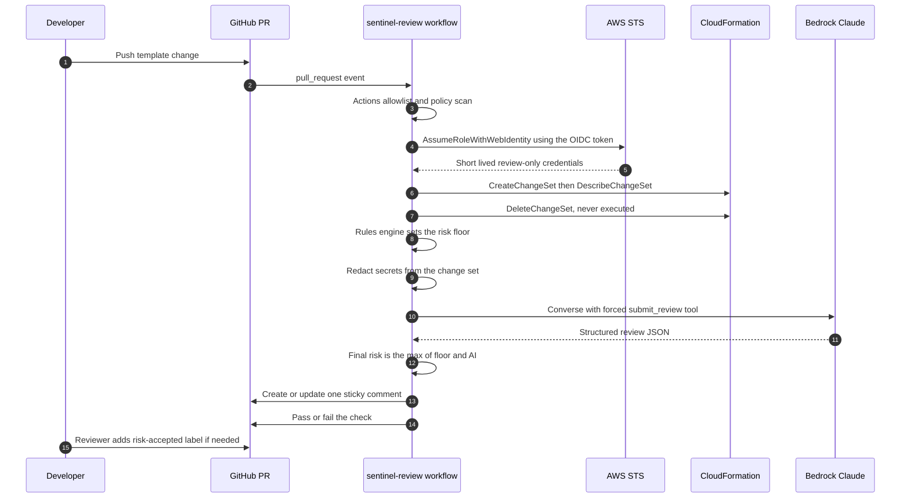

# Architecture

## Flow

## Components

| Component | File | Responsibility |
|---|---|---|
| Reusable workflow | `.github/workflows/sentinel-review.yml` | Wires the steps, owns permissions, enforces results |
| Change set action | `actions/changeset` | Create, describe with property values, always delete |
| Policy scan action | `actions/policy-scan` | cfn-lint, cfn-guard org rules, Trivy |
| Allowlist action | `actions/allowlist` | Approved and pinned GitHub Actions only |
| AI review action | `actions/ai-review` | Installs the package, runs `python -m sentinel review --github` |
| Parser | `sentinel/changeset.py` | describe-change-set JSON to typed objects |
| Rules engine | `sentinel/risk.py` | Deterministic findings and the floor |
| Redaction | `sentinel/redact.py` | Key based and pattern based secret removal |
| Prompt | `sentinel/prompt.py` | Redacted, size capped model input |
| Providers | `sentinel/llm.py` | Bedrock Converse, Anthropic API, rule-based |
| Orchestration | `sentinel/review.py` | Floor rule and fallback on model failure |
| Gate | `sentinel/gate.py` | Threshold plus human approval label |
| Report | `sentinel/report.py` | Markdown for the PR comment and job summary |
| GitHub client | `sentinel/github.py` | Sticky comment, labels, label actor for audit |

## Trust boundaries

1. **GitHub to AWS.** OIDC only. The trust policy pins `aud` to `sts.amazonaws.com` and `sub`
   to `repo:OWNER/REPO:pull_request`. Fork PRs get no OIDC token, so they cannot assume the role.
2. **Runner to CloudFormation.** The role can create, describe and delete change sets for
   stacks under one name prefix. An explicit Deny covers execute and every stack mutation.
3. **Runner to the model.** Only the output of `prompt.build_payload` leaves the runner, after
   redaction. The model never sees raw parameters or property values that look like secrets.
4. **Model to the gate.** Model output is parsed into a fixed schema. Its risk level can only
   raise the floor. If the call fails or the output is malformed, the rule-based narrative is
   used and the gate still runs.

## Failure modes

| Failure | Behavior |
|---|---|
| Bedrock throttled, down, or model access missing | Rule-based report, note in the comment, gate unchanged |
| Model returns malformed JSON or skips the tool | Same as above |
| Change set has no changes | Treated as empty, LOW, check passes |
| Template invalid | Change set step fails, check fails with the CloudFormation reason |
| New stack | CREATE change set. CloudFormation leaves an empty stack in REVIEW_IN_PROGRESS (no resources, no cost). Later reviews keep using CREATE until the deploy pipeline creates the stack |
| Template over 51,200 bytes | Not supported yet (needs an S3 template URL), see Roadmap |

## Why forced tool use

The Converse call sets `toolChoice` to the single `submit_review` tool, so the model must
answer with JSON that matches `REVIEW_SCHEMA`. That removes free text parsing, makes the
output testable, and lets the report render the same sections every time.
